

  

  
  
  
  
  

<b>A <a href="https://github.com/radhepa/Village-Friends-Minecraft-Mod">Village Friends</a> add-on that makes the sea worth exploring.</b> 
Ten rare sites to find at sea, from a lighthouse on a rocky islet to black pearls in the deep. 
Three of them are lived in, and their people will tell you where the others are.

---

## The ten sites

  
  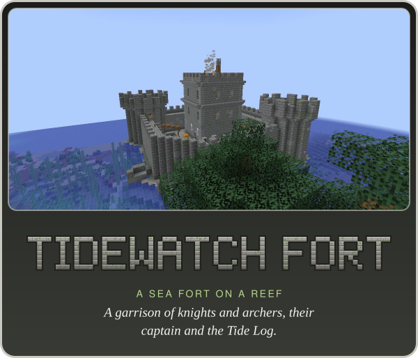
  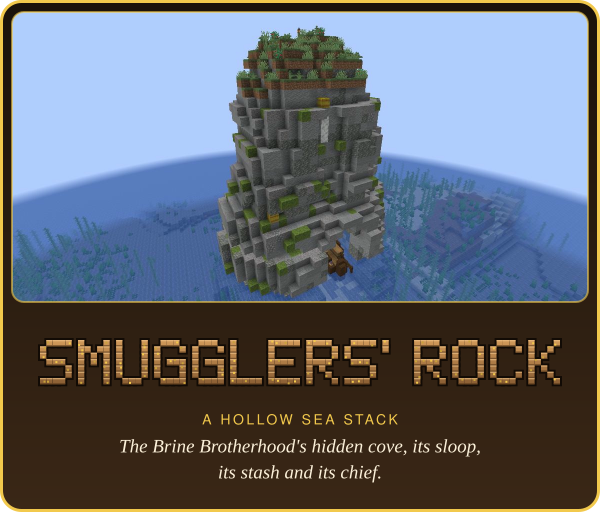
  
  
  
  
  
  
  

| Site | Where | What you find |
|---|---|---|
| Lighthouse Isle | on a rocky islet | a lighthouse and its keeper, who sells Sea Charts to the other sites |
| Tidewatch Fort | a sea fort on a reef | a garrison of knights and archers, their captain and the Tide Log |
| Smugglers' Rock | a hollow sea stack | the Brine Brotherhood's hidden cove, its sloop, its stash and its chief |
| The Sunken Galleon | on the sea floor | the *Golden Heron*, broken in two; its strongroom; its drowned captain |
| The Whalefall | on the sea floor | the bones of a colossal whale, alive with coral; ambergris |
| The Drowned Sanctum | half-buried | a temple of the Old Tide: a great eye, a flooded nave, a sealed reliquary |
| The Pearl Grotto | a sea cave | giant clams with pearls, and a pearl diver's camp in an air pocket |
| Wexley's Diving Bell | surface and floor | a salvage barge, and a copper bell with air inside and the diving helmet |
| The Frozen Hold | in frozen seas | the expedition ship *Northward*, locked in an iceberg |
| The Ember Vents | the deep ocean | smoking chimneys, tube worms, an Old Tide fire-shrine, black pearls |

## The people at sea

The lightkeeper, the Tidewatch and the smugglers are Village Friends residents: talk to them, trade, make friends.
They have their own lines and tell you about the nearest other site.

<table>
  <tr>
    <td width="33%">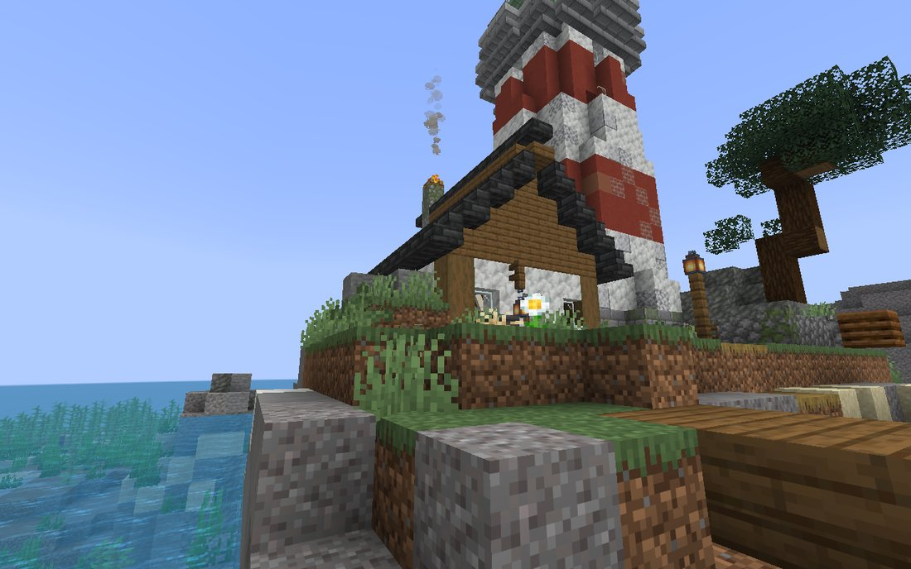 The keeper's cottage under the light.</td>
    <td width="33%">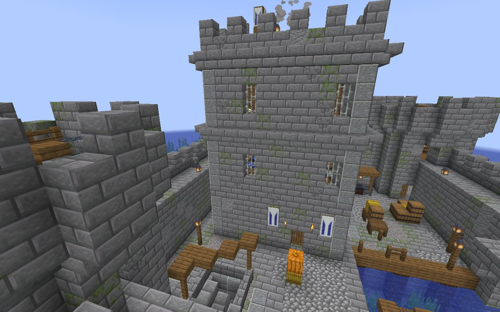 The Tidewatch keep.</td>
    <td width="33%">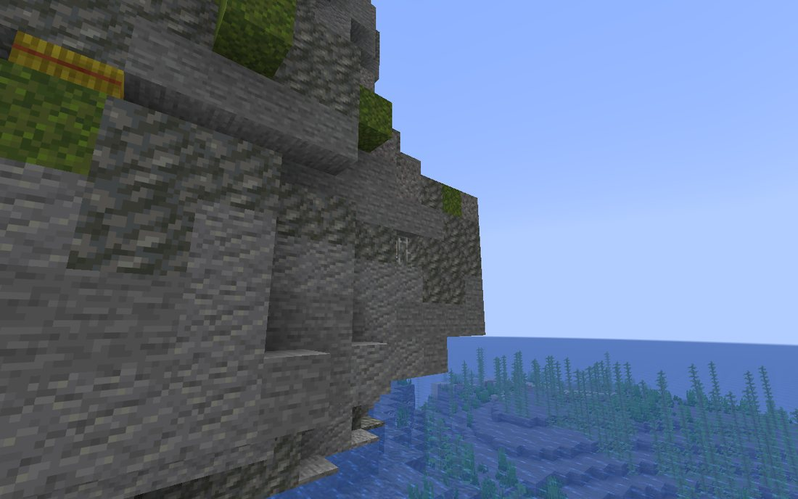 Smugglers' Rock, up close.</td>
  </tr>
  <tr>
    <td width="33%">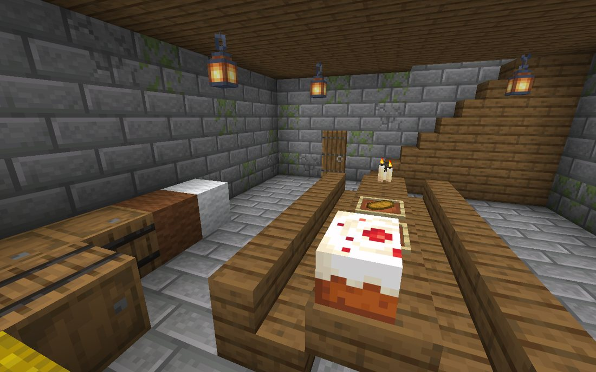 Inside Tidewatch Fort.</td>
    <td width="33%">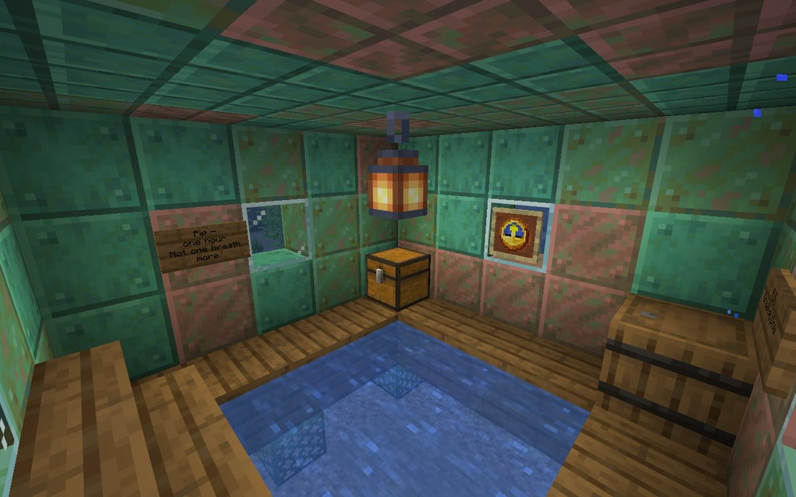 Air inside Wexley's bell.</td>
    <td width="33%">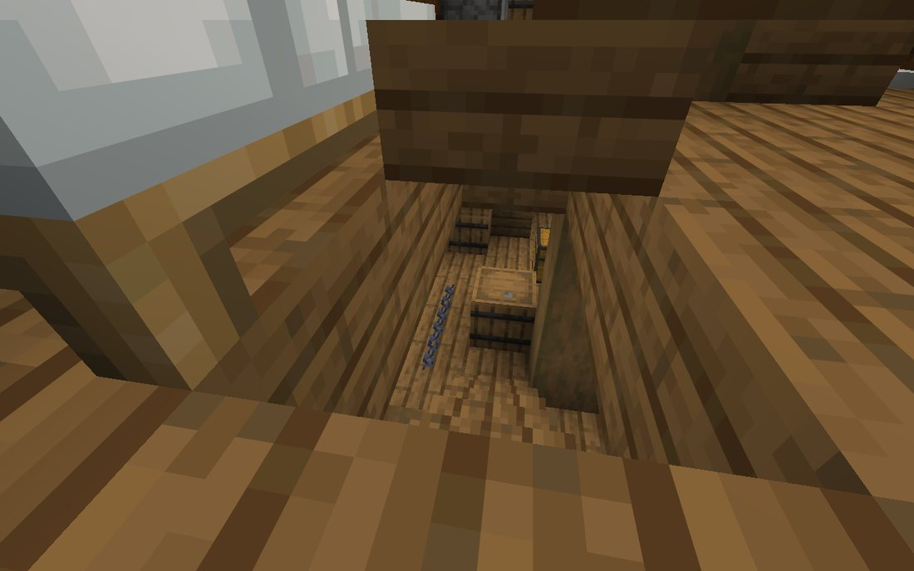 Aboard the <i>Northward</i>.</td>
  </tr>
</table>

## New blocks and items

Giant clams (reach in for a pearl; they grow another), tube worms, barnacles, sea glass and its pane, the
lightkeeper's signal lamp and the smugglers' contraband crate (their job sites), pearls, black pearls, ambergris, the
**storm glass** (it reads the weather ahead) and the **diving helmet** (breathe under water while you wear it).

---

## Requirements

- Minecraft 26.3, Fabric Loader 0.19.5+, Fabric API
- [Village Friends](https://github.com/radhepa/Village-Friends-Minecraft-Mod) 2.29.0 or newer
- Plays well with [Sea Friends](https://github.com/radhepa/Sea-Friends) (its villages and our sites keep apart, and
  the sea folk know the sites) and the rest of the Village Friends modpack.

## Settings

`config/oceanexpansion.json`: `rarity` (1.0; 2.0 = half as many per side, 0.5 = twice as many) and `rumors`.

## Building

`build.ps1` (or `gradlew build`).

| What | How |
|---|---|
| The sites | `python tools/sites/build.py` |
| Dialogue | `python tools/talk/talk.py` |
| Block and item art | `python tools/art/blocks.py` |

See [DESIGN.md](DESIGN.md).

## License

[MIT](LICENSE). The README art in `docs/readme/` is drawn from in-game screenshots.
